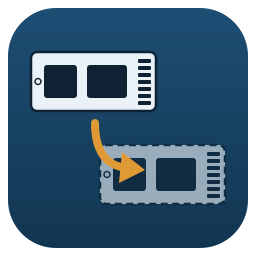

<p align="center"></p>

# Calque

**Français** · [English](#english)

Cloner un disque — **Windows compris** — sur un disque plus grand, prêt à démarrer.

- **Windows** : copie à chaud du disque système, grâce à un cliché instantané (VSS). On continue à
  travailler pendant la copie.
- **Linux** : copie depuis une clé USB « live », Windows éteint.
- Tables **GPT** et **MBR** recopiées avec leurs identifiants : le clone démarre sans réparation.
- Seuls les blocs **occupés** des volumes NTFS sont copiés ; chaque bloc est **relu et comparé**.
- La partition de récupération est reportée en fin de disque : l'espace gagné se retrouve juste
  derrière C:, et l'onglet *Après le clonage* l'y ajoute d'un clic.
- Refus expliqués des cas qui donnent un clone qui ne démarre pas : boîtier USB qui présente des
  secteurs de 4096 octets, BitLocker actif, disque dynamique, cible trop petite.
- **Boîtier USB qui décroche** (il chauffe) : Calque attend son retour et continue seul ; sinon il
  s'arrête proprement, et **Reprendre** repart là où la copie s'était arrêtée. Copie bridée en option
  pour le ménager ; veille de Windows bloquée pendant la copie.
- **Secteurs illisibles** sur la source : avertissement clair, puis « Continuer malgré tout ».
- Le disque source n'est jamais modifié ; une interruption ne laisse jamais une cible qui pourrait
  passer pour un clone complet.

## Télécharger

| Système | Fichier |
|---|---|
| Windows 10/11 | [Calque-Setup.exe](https://github.com/ARP273-ROSE/Calque/releases/latest/download/Calque-Setup.exe) |
| Linux x86_64 | [Calque-linux-x86_64.tar.gz](https://github.com/ARP273-ROSE/Calque/releases/latest/download/Calque-linux-x86_64.tar.gz) |
| Linux ARM64 | [Calque-linux-arm64.tar.gz](https://github.com/ARP273-ROSE/Calque/releases/latest/download/Calque-linux-arm64.tar.gz) |

Le paquet macOS est publié par la chaîne commune mais n'accède pas aux disques : Calque est fait pour
Windows et Linux.

Manuel : [français](docs/manuel-fr.pdf) · [English](docs/manuel-en.pdf).

## Ligne de commande

```
calque --lister                        # disques : numéro, modèle, taille, secteurs
calque --cloner 0 2                    # Windows : disque 0 vers disque 2
sudo calque --cloner /dev/nvme0n1 /dev/sdb
```

## Développement

```
pip install -r requirements.txt pytest
python -m pytest -q tests     # sous Linux, avec gdisk, ntfs-3g, dosfstools, fdisk : vrais disques image
```

La CI Windows fait un clonage réel entre deux disques virtuels VHDX, cliché VSS compris
(`tests/test_windows_vhd.py`).

---

<a name="english"></a>
# Calque (English)

Clone a disk — **Windows included** — to a larger disk, ready to boot.

- **Windows**: hot copy of the system disk through a snapshot (VSS). You can keep working.
- **Linux**: copy from a live USB stick, with Windows shut down.
- **GPT** and **MBR** tables copied with their identifiers: the clone boots with no repair.
- Only the **used** blocks of NTFS volumes are copied; every block is **read back and compared**.
- The recovery partition moves to the end of the disk: the space gained sits right after C:, and the
  *After cloning* tab adds it in one click.
- Explained refusals for what makes a clone unbootable: USB enclosure presenting 4096-byte sectors,
  active BitLocker, dynamic disk, target too small.
- **USB enclosure dropping out** (it heats up): Calque waits for it and carries on; otherwise it stops
  cleanly and **Resume** continues where the copy stopped. Optional capped speed to spare it; Windows
  sleep blocked during the copy.
- **Unreadable sectors** on the source: clear warning, then “Continue anyway”.
- The source disk is never modified; an interruption never leaves a target that could pass for a
  complete clone.

Downloads: see the table above. User guide: [English](docs/manuel-en.pdf).

Licence: MIT. Fonts: Source Sans 3 and EB Garamond (SIL Open Font License).
